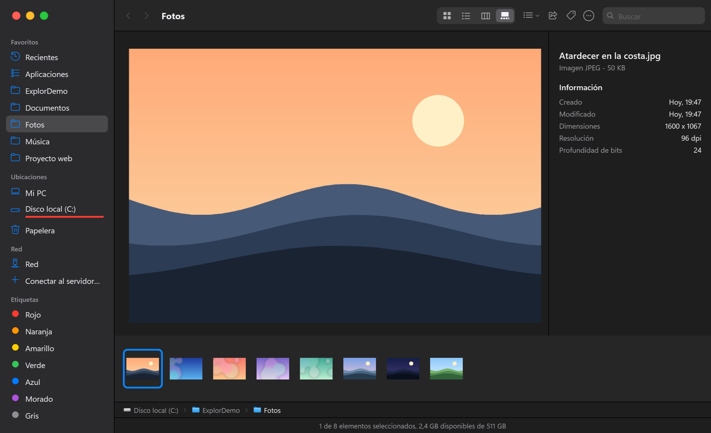
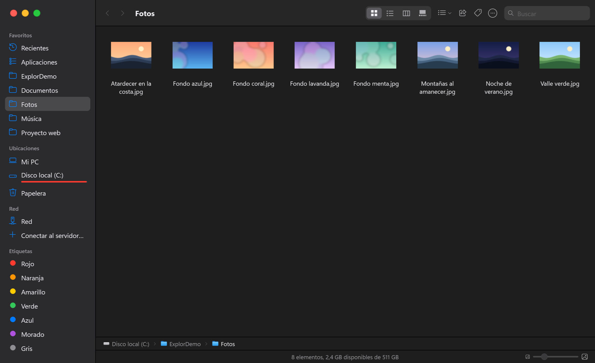
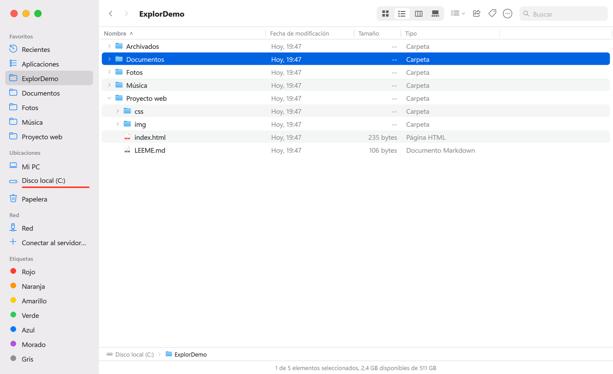
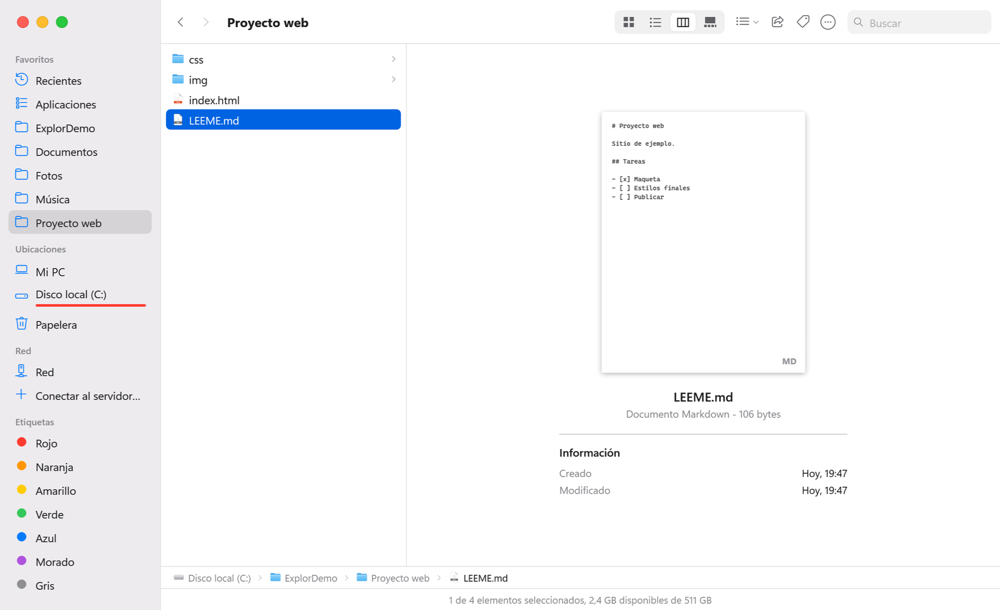

# Explor

Explorador de archivos para Windows con una interfaz limpia y fluida, centrado en vistas cómodas, vista previa instantánea y copias de archivos fiables.



## Características

- **Cuatro vistas**: iconos, lista (con carpetas que se despliegan en el sitio), columnas con panel de vista previa y galería.
- **Pestañas y sesión**: abre varias carpetas en pestañas; al volver a abrir la aplicación se recuperan las pestañas, las vistas y la ventana.
- **Barra lateral**: favoritos que se reordenan arrastrando, discos con su espacio libre, Papelera, red y etiquetas de color.
- **Vista rápida (Espacio)**: imágenes, PDF, texto y código (con edición), Markdown, el contenido de los comprimidos, audio y vídeo con reproductor propio (los controles se ocultan solos) y atajos de teclado.
- **Abrir con**: lista las aplicaciones que Windows recomienda para cada tipo de archivo y, para texto y código, los editores instalados.
- **Comprimidos**: comprime en ZIP y descomprime ZIP; con [7-Zip](https://www.7-zip.org/) instalado, también 7z, RAR, tar.gz y otros.
- **Motor de copia propio**: copia en paralelo los archivos pequeños y por bloques los grandes; si un disco o la red se desconectan, espera y reanuda desde el último bloque confirmado; tras un cierre inesperado ofrece continuar la operación. Al mover entre discos, los originales se borran solo cuando cada copia está confirmada.
- **Deshacer (Ctrl+Z)** para renombrar, mover, copiar, duplicar, crear carpetas y enviar a la Papelera.
- **Búsqueda**: usa [Everything](https://www.voidtools.com/) si está instalado, después el índice de Windows y, si no hay ninguno, un escaneo paralelo propio. Admite filtros como `tipo:imagen`, `ext:psd,ai` o `*.mp4`.
- **Red**: «Conectar al servidor» (Ctrl+K) acepta `\\equipo\recurso`, una IP o `smb://equipo/recurso`, y pide usuario y contraseña con la ventana estándar de Windows.
- **Aplicaciones y Recientes**: lista de programas instalados (abrir, ejecutar como administrador, desinstalar) y documentos usados hace poco.
- **Integración con Windows**: menú contextual del sistema, «Abrir en Explor» en el menú de carpetas y discos, tema claro y oscuro según el sistema, y ventana «Obtener información» (Ctrl+I).

| Vista de iconos | Lista (tema claro) | Columnas con vista previa |
| --- | --- | --- |
|  |  |  |

## Requisitos

- Windows 10 versión 1809 o posterior, o Windows 11 (x64).
- Para compilar: [SDK de .NET 8](https://dotnet.microsoft.com/download/dotnet/8.0).
- Opcional, para generar el instalador: [Inno Setup 6](https://jrsoftware.org/isinfo.php).

## Compilar y ejecutar

```powershell
git clone https://github.com/jorshuadev/Explor.git
cd Explor

# Compilar la solución
dotnet build Faro.sln -c Release

# Ejecutar
dotnet run --project src\Faro -c Release
```

Versión autocontenida (no necesita tener .NET instalado):

```powershell
dotnet publish src\Faro -c Release -r win-x64 --self-contained true -p:PublishReadyToRun=true -o publish
```

Instalador por usuario (no pide permisos de administrador), a partir de la carpeta `publish`:

```powershell
& "C:\Program Files (x86)\Inno Setup 6\ISCC.exe" installer\Faro.iss
# El instalador queda en dist\Explor-Setup-1.0.0.exe
```

## Estructura

```
Faro.sln
├── src/Faro/           Aplicación WPF: ventanas, vistas, barra lateral, vista rápida, menús
├── src/Faro.Core/      Núcleo sin interfaz: motor de copia reanudable, búsqueda, tipos de archivo, etiquetas
├── tests/Faro.Tests/   Banco de pruebas en consola del núcleo (copias, verificación, búsqueda)
├── installer/          Script de Inno Setup
└── docs/screenshots/   Capturas
```

«Faro» es el nombre interno del proyecto (espacios de nombres y solución); el nombre de la aplicación es Explor.

Los ajustes se guardan en `%APPDATA%\Explor` y los registros y diarios de copia en `%LOCALAPPDATA%\Explor`.

## Aviso

Explor es un proyecto independiente inspirado en el diseño y la forma de trabajar del Finder de macOS. No está afiliado, patrocinado ni respaldado por Apple Inc. Apple, Finder y macOS son marcas comerciales de Apple Inc., registradas en EE. UU. y otros países; se mencionan solo como referencia. Explor no incluye código, iconos, fuentes, sonidos ni otros recursos de Apple: usa las fuentes y los símbolos de Windows (Segoe UI y Segoe Fluent Icons), y sus iconos se dibujan desde el propio código.

## Licencia

Distribuido bajo la licencia MIT. Consulta [LICENSE](LICENSE).
